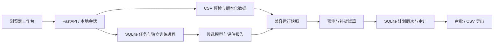

# 零售预测与补货工作台

面向零售运营的本地决策应用：从销售与库存数据校验出发，完成需求预测、补货试算、角色审批和可追溯导出。

项目使用固定种子的生成数据，适合面试演示和工程实践。模型指标用于验证评估流程，不代表真实企业收益。当前版本为 **Local Demo V2**；完整功能与已测边界见[验收记录](docs/local-demo-v2-acceptance-2026-09-22.md)。

## 快速启动

推荐 Windows 原生入口，无需先启动 Docker。准备 Python 3.11 与 PowerShell，在仓库根目录执行：

```powershell
python -m venv .venv
.\.venv\Scripts\Activate.ps1
python -m pip install -r backend/requirements-dev.txt

# 首次准备数据与模型，需要等待 CPU 训练完成
python scripts/prepare_demo.py --root .demo-runtime

# 面试当天只需启动；开启本地角色审批
scripts\start_demo.ps1 -Root .demo-runtime -WithAuth
```

打开 <http://127.0.0.1:3000>。顶部「演示路线」可按七个业务环节导航；完整讲稿见[面试演示](docs/interview-demo.md)。服务仅监听本机地址，前端与 API 使用同源入口。

| 演示账号 | 密码 | 主要操作 |
| --- | --- | --- |
| `analyst` | `demo-analyst` | 查看分析、试算、创建和提交计划 |
| `approver` | `demo-approver` | 审批、驳回计划 |
| `admin` | `demo-admin` | 管理数据与模型、场景、备份和审计 |

这些账号仅在显式启用演示鉴权时使用。省略 `-WithAuth` 可以快速浏览兼容模式；需要展示权限时使用上面的完整命令。

```powershell
scripts\stop_demo.ps1 -Root .demo-runtime

# 端口被占用时换一组；浏览器访问 13026，无需注入 API 地址
scripts\start_demo.ps1 -Root .demo-runtime -BackendPort 18026 -FrontendPort 13026 -WithAuth
```

首次安装与模型准备允许联网，面试前完成即可。启动器不会在每次启动时重新训练；用 `--force` 重建资源前应先备份演示目录。

## 完整业务闭环

| 模块 | 可操作能力 | 体现的工程设计 |
| --- | --- | --- |
| 经营总览 | KPI、商品/门店筛选、趋势与库存风险 | 统一聚合口径与版本来源 |
| 数据中心 | CSV 模板、行级预检、候选版本、快照发布/回滚 | 坏输入隔离、兼容性校验、单指针切换 |
| 模型中心 | 训练提交、阶段/失败重试、评估、人工激活 | 持久化任务、候选隔离、训练期间继续服务 |
| 预测分析 | 历史与未来 30 天明细、基线对比、CSV | 时间切分、同窗口评估、来源追溯 |
| 库存决策 | 风险筛选、参数试算、批量调整与草案 | 服务端统一公式、MOQ/包装取整、调整原因 |
| 计划中心 | 提交、批准/驳回、修订、审计、导出 | 角色权限、乐观锁、幂等与不可变版次 |
| 演示系统 | 异常场景、健康、备份/恢复、诊断包 | 受控运行目录、完整性校验、敏感信息排除 |

批准表示内部审核通过，不表示已向供应商下单。页面区分生成数据、业务日期与机器本地日期。

## 架构与取舍



- **模型按证据选择**：LSTM、LightGBM、7 日季节性朴素基线和候选集成在相同窗口比较；验证集 WAPE 决定策略，测试集做最终评估。基线胜出是合法结果。
- **时间切分防止泄漏**：按时间划分 train/validation/test（60/20/20），评估说明窗口、样本与单位；预测情景范围不称为统计置信区间。
- **候选与活动状态分离**：上传和训练先产生候选，人工发布兼容运行快照后才进入服务；失败不覆盖当前活动结果。
- **业务写入可追溯**：草案保存来源版本，审批使用权限检查、乐观版本号和幂等处理；重启后计划与审计可恢复。
- **单机优先**：FastAPI、原生 JavaScript/ECharts、SQLite 和版本化文件，优先保证本地演示易理解、可复现。

## 项目结构

```text
backend/app/       API、领域服务、存储、配置与健康检查
backend/ml/        数据生成、特征工程、训练、回测和推理
backend/tests/     API、业务规则、迁移和运行入口测试
frontend/          原生 JavaScript 工作台、内置 ECharts、浏览器测试
scripts/           本地启动、资源准备、导入、恢复与验证工具
docs/              演示讲稿、部署恢复手册、验收证据
.demo-runtime/     本地生成资源、数据库和日志（Git 忽略）
```

生成数据、模型权重、数据库、日志和缓存不提交到 GitHub。内置 ECharts 用于离线加载，无需 CDN。

## 验证

```powershell
python -m pytest backend/tests -q --cov=backend/app --cov=backend/common --cov-fail-under=85
python -m ruff check backend scripts
docker compose config --quiet

# 安装一次浏览器测试依赖（需要 Node.js）
npm --prefix frontend ci
cd frontend
npx playwright install chromium
cd ..

# 在进程级离线守卫下启动、执行完整鉴权业务回放并停止
scripts\verify_offline_demo.ps1 -Root .demo-runtime -RunFullReplayE2E
```

完整回放会把指定的独立演示目录恢复为 `standard` 场景，并产生测试计划等记录。请使用演示数据目录。其他检查开关及固定硬件验收要求见[实施计划](docs/local-demo-plan.md)。

GitHub Actions 包含后端质量门、依赖审计、Docker 浏览器回归和 Windows 原生启动检查。远程结果以 [Actions](https://github.com/Caser-86/sales-forecast-dashboard/actions) 中对应提交为准，历史验收记录有各自的执行日期。

## 部署与运维

Docker Compose 是可选运行入口，首次需要生成挂载目录中的数据与模型：

```powershell
python scripts/init_data.py
python scripts/train_models.py
docker compose up --build -d
docker compose down
```

Compose 前端默认在 <http://localhost:3000>，API 文档在 <http://localhost:8000/docs>（非 production）。详细步骤见[部署检查单](docs/deployment-checklist.md)，版本故障处理见[恢复手册](docs/recovery-runbook.md)。本地原生入口通过 `scripts/serve_demo.py` 转发 `/api` 与 `/health`；如自行使用普通静态服务器，需在加载 `api.js` 前显式配置 `window.API_BASE_URL`，并设置后端 CORS 白名单。

后端配置定义在 `backend/app/core/config.py`。常用设置：

| 配置 | 作用 |
| --- | --- |
| `DEMO_ROOT` | 隔离本地数据、模型、计划与日志；启动器自动设置 |
| `DEMO_AUTH_ENABLED` | 本地演示会话鉴权；启动器 `-WithAuth` 开启 |
| `API_TOKEN` | API Token 鉴权；production 需要配置 |
| `CORS_ORIGINS` | 需要跨源开发时的明确来源白名单 |
| `FORECAST_WORKERS` | 批量预测并发数，默认 4 |

根目录 `.env` 用于 Compose；后端本地环境可通过环境变量或 `backend/.env` 覆盖。密钥不得提交到 Git。

## 当前边界

已具备本地角色审批、模型人工发布/回滚、备份恢复与进程级离线回归。物理固定 4 核/8GB 的容量验证与完全断网人工复演仍未完成，详见 [T10 现场记录](docs/t10-manual-evidence-template.md)。

真实 ERP/WMS 接入、企业 SSO、生产密钥托管、定时训练、漂移告警、多租户和多副本部署属于后续范围。项目状态见 [CONTEXT](CONTEXT.md)，未完成事项见 [TODO](TODO.md)。
